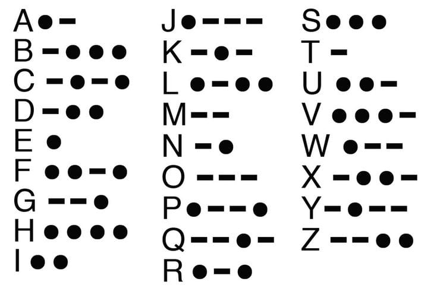
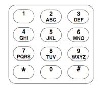

# 🔎 Escape Room: Assassino à Solta

> [!CAUTION]
> **Alerta de spoiler:** Para não estragar a sua experiência com o jogo, **não abra o arquivo de código `.ino`** antes de jogar.

## 📖 Introdução

Bem-vindo ao escape room **Assassino à Solta**!

Você está preso dentro de uma casa e precisa desvendar os mistérios espalhados pelo ambiente para descobrir quem é o assassino à solta antes que ele volte e você se torne a próxima vítima. A polícia já reuniu **4 suspeitos** e **4 possíveis armas do crime** — agora cabe a você conectar as pistas e resolver o caso a tempo.

---

## 🕵️ Suspeitos e Possíveis Armas do Crime


### Suspeitos

| Suspeito | Características |
| :--- | :--- |
| **Anab** | Mulher, cabelos ruivos em tranças, maquiagem, óculos e roupas brancas. |
| **Chuck** | Homem, cabelo ruivo liso, óculos e roupas coloridas. |
| **Samara** | Mulher, cabelo ruivo liso, maquiagem, olhos brancos e roupas brancas. |
| **Noiva** | Mulher, cabelo loiro ondulado, maquiagem, óculos e vestido de noiva branco. |

### Possíveis Armas do Crime

* Veneno
* Espingarda
* Faca
* Serra Elétrica

---

## 🎮 Manual: Como Jogar

### 🎯 Objetivo e Regras Gerais

Você tem **12 minutos** para concluir os **4 minigames** da casa: **Sintonização de Rádio**, **Sequência de LEDs**, **Código Morse** e **Discagem**. Cada minigame concluído desbloqueia uma pista sobre a aparência do assassino, além de informações essenciais para os demais enigmas.

* **Penalidades:** Cada erro nos minigames da **Sequência de LEDs** e do **Código Morse** desconta **30 segundos** do cronômetro.
* **Limite de erros:** Você pode cometer no máximo **3 penalidades** ao longo da partida. Se ultrapassar esse limite, o assassino chega à casa e o jogo termina.

---

### 1. 📻 Sintonização de Rádio

Sintonize a frequência correta do rádio utilizando o **potenciômetro** até o **buzzer parar** e o **display ligar**.

* **Recompensa:** Desbloqueia a visualização do tempo restante no display e libera uma pista sobre o assassino.

### 2. 💡 Sequência de LEDs

Observe a sequência em que os LEDs piscam e repita a ordem correta ao longo de **4 rodadas** progressivas (com **2, 3, 4 e 5** piscadas aleatórias, respectivamente).

* **Controles:** Há 4 LEDs (**vermelho, amarelo, verde e azul**), cada um alinhado ao seu respectivo botão. Ao terminar de reproduzir a sequência da rodada, pressione o **5º botão** (sem LED associado) para confirmar.
* **Penalidade:** Confirmar uma sequência incorreta gera 1 penalidade e desconta **30 segundos** do cronômetro.

### 3. ⌨️ Código Morse

Escreva o nome da **arma do crime** em **Código Morse** (consulte a lista de armas na introdução e o alfabeto Morse no final desta seção).

* **Controles:**
  * Botão mais à direita (LED vermelho): **PONTO (`.`)**
  * Botão ao lado (LED amarelo): **TRAÇO (`-`)**
  * **Confirmar letra:** Pressione os dois botões (vermelho + amarelo) **ao mesmo tempo, 1 vez**.
  * **Confirmar palavra:** Pressione os dois botões (vermelho + amarelo) **ao mesmo tempo, 2 vezes**.
* **Penalidade:** Confirmar uma palavra incorreta gera 1 penalidade e desconta **30 segundos** do cronômetro.

### 4. 📞 Discagem

Use o **teclado numérico (keypad)** para ligar para a polícia e digitar o **nome do assassino** no padrão de teclado telefônico (consulte o guia visual abaixo).

> [!WARNING]
> **Chance única:** Você tem apenas **uma tentativa** para informar o nome do assassino. Se acertar, vence o jogo; se errar, o assassino chega à casa e você perde imediatamente.

### 🔄 Reiniciar a Partida

Ao final do jogo (seja após vencer ou perder), você pode iniciar uma nova partida pressionando o botão **`R`** na interface.

### 📑 Guias Visuais de Apoio

**Alfabeto Morse**


**Teclado Telefônico**


---

## 🛠️ Hardware e Montagem

### Lista de Componentes

* 1x Arduino Uno
* 1x Display LCD 16x2 com módulo I2C
* 1x Potenciômetro
* 1x Buzzer
* 4x LEDs (vermelho, amarelo, verde e azul)
* 4x Resistores (para os LEDs)
* 5x Push buttons (botões)
* 1x Teclado matricial 4x3 (keypad)
* 1x Expansor I2C PCF8574
* Protoboard e jumpers

### Esquema de Ligação

| Componente | Pino no Arduino | Observação |
| :--- | :---: | :--- |
| Potenciômetro (Rádio) | `A0` | Sintoniza entre 600 e 700. |
| Botão Vermelho / Ponto | `A1` | Pull-up interno; botão ligado ao GND. |
| Botão Amarelo / Traço | `A2` | Pull-up interno; botão ligado ao GND. |
| Botão Verde | `D11` | Pull-up interno; botão ligado ao GND. |
| Botão Azul | `D10` | Pull-up interno; botão ligado ao GND. |
| Botão CONFIRMA | `D2` | Botão ligado ao GND. |
| LED Vermelho | `D7` | Com resistor em série. |
| LED Amarelo | `D3` | Com resistor em série. |
| LED Verde | `D5` | Com resistor em série. |
| LED Azul | `D4` | Com resistor em série. |
| Buzzer | `D6` | Precisa ser o `D6`, porque o som sai do `Timer0`. |
| LCD 16x2 I2C – SDA | `A4` | Endereço `0x27`. |
| LCD 16x2 I2C – SCL | `A5` | Endereço `0x27`. |
| Teclado (expansor PCF8574) – SDA | `D8` | I2C por software, endereço `0x27`. |
| Teclado (expansor PCF8574) – SCL | `D9` | I2C por software. |

#### Teclado 4x3 no Expansor PCF8574

| Pino do Expansor | Função |
| :--- | :--- |
| `P0`, `P1`, `P2`, `P4` | Linhas 1, 2, 3 e 4 (`bitsLinhas`) |
| `P5`, `P6`, `P7` | Colunas 1, 2 e 3 (`bitsColunas`) |
| `P3` | Não usado |

---

## 💻 Código e Instalação

### Pré-requisitos e Bibliotecas

* **Arduino IDE** (ou ambiente equivalente)
* **Bibliotecas C/C++ (Arduino):**
  * Nativas: `<avr/io.h>`, `<avr/interrupt.h>`, `<stdlib.h>`, `<util/delay.h>`, `<string.h>`
  * Externas (instalar pelo Gerenciador de Bibliotecas): `<LiquidCrystal_I2C.h>`, `<SoftwareWire.h>`
* **Python 3** instalado (no Windows, marque a opção **"Add python.exe to PATH"** durante a instalação)
* **Bibliotecas Python:** `pygame-ce` e `pyserial`
* **Arduino** conectado via USB com o código já gravado (ou Arduino IDE instalada, caso precise carregar o código na placa)

### Passo a Passo

#### 1. Baixar o repositório

Clone o projeto pelo GitHub ou baixe o arquivo `.zip` e extraia no computador. Caso use o terminal:

```bash
git clone [https://github.com/SEU-USUARIO/Escape_Room-Assassino_a_solta.git](https://github.com/SEU-USUARIO/Escape_Room-Assassino_a_solta.git)
cd Escape_Room-Assassino_a_solta
```

#### 2. Configurar o ambiente Python

Na pasta raiz do projeto, abra o terminal e crie o ambiente virtual:

```bash
python -m venv venv
```

Ative o ambiente virtual (Windows / PowerShell):

```powershell
.\venv\Scripts\activate
```

> [!NOTE]
> Se o PowerShell bloquear a execução de scripts, execute antes o comando abaixo, confirme com `S` e tente ativar novamente:
> ```powershell
> Set-ExecutionPolicy -Scope CurrentUser RemoteSigned
> ```

Instale as bibliotecas necessárias:

```bash
pip install pygame-ce pyserial
```

#### 3. Configurar o Arduino e a Porta COM

**Caso precise gravar o código na placa:**
1. Abra o arquivo `escape_room__main/escape_room__main.ino` na Arduino IDE.
2. Instale as bibliotecas `LiquidCrystal_I2C` e `SoftwareWire` pelo Gerenciador de Bibliotecas.
3. Selecione a placa e a porta corretas e clique em **Carregar (Upload)**.
4. Feche o **Monitor Serial** após o upload (a porta serial só pode ser usada por um programa por vez).

**Para ajustar a porta no Python:**
1. Conecte o Arduino ao USB e verifique qual porta foi atribuída (no Windows: `Win + X` > **Gerenciador de Dispositivos** > **Portas (COM e LPT)**). Se usar Arduino genérico com chip CH340 e aparecer um aviso amarelo, instale o driver CH340.
2. Abra o arquivo `front_end/main.py` e atualize a variável `PORTA_SERIAL` no topo (linha 50) com a porta encontrada (ex.: `"COM3"`, `"COM4"`).

#### 4. Executar o jogo

Com o ambiente virtual (`venv`) ativado na pasta raiz do projeto, execute:

```bash
python front_end/main.py
```

---

## 👥 Autores, Créditos e Licença

### Autores

Este projeto foi desenvolvido por:

* [@aliceprsilva](https://github.com/aliceprsilva)
* [@Gabrielaguilhon](https://github.com/Gabrielaguilhon)
* [@luiza250805](https://github.com/luiza250805)

### Créditos e Recursos Visuais

* **Imagens e sprites utilizados no jogo:**
  * Personagem: [Top-Down Pixel Art Character (Itch.io)](https://gandalfhardcore.itch.io/top-down-pixel-art-character)
  * Telefone: [Retro Phone Pixel Art (Vecteezy)](https://pt.vecteezy.com/arte-vetorial/7816880-vector-pixel-art-retro-phone-for-game-development)
  * Rádio: [Rádio Fita Pixel Art (Vecteezy)](https://pt.vecteezy.com/arte-vetorial/21195094-uma-radio-fita-dentro-pixel-arte-estilo)
  * Luzes: [Christmas Lights Pixel Art (Adobe Stock)](https://stock.adobe.com/br/images/christmas-lights-pixel-art-isolated-on-white-background-pixel-art-vector-illustration-pixel-design-illustration-bit-icon/535985521)
  * Máquina de escrever: [Pixel Art Máquina de Escrever (Colab55)](https://www.colab55.com/@pixelcarvel/bodies/pixel-art-maquina-de-escrever)
  * Suspeitos e armas: Geradas pela IA Gemini
* **Guias de apoio:**
  * Alfabeto Morse: [Referência no Pinterest](https://br.pinterest.com/pin/318137161180128867/)
  * Teclado telefônico: [Olimpíada Brasileira de Informática (OBI / UNICAMP)](https://olimpiada.ic.unicamp.br/pratique/pj/2008/f1/telefone2/)

### Licença

Este projeto foi desenvolvido para fins acadêmicos.
